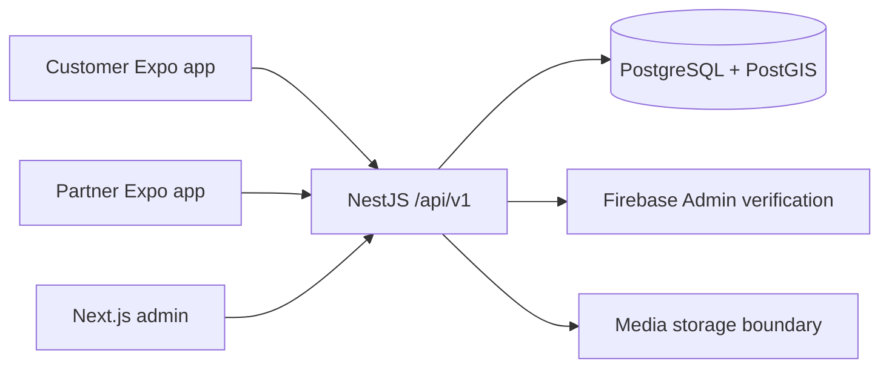

# Architecture

## Boundaries

VenueVista starts as a modular monolith: one versioned REST API owns authorization,
business rules, and database access. The Customer and Partner apps have independent
Expo Router navigation and release identities. The Next.js admin app is a separate
server-rendered application with a server-side session boundary. Clients never
connect directly to PostgreSQL or carry privileged Firebase/storage credentials.

The API groups authentication/users, organizations, venues/spaces/media,
discovery/locations, wishlists, enquiries/quotes/site visits/bookings,
notifications, and administration/audit records. Shared packages contain contracts
and utilities rather than a second source of business authorization. Prisma
migrations are authoritative for schema changes; SQL handles PostGIS and booking
exclusion constraints that cannot be fully represented in Prisma.

## Identity and permissions

Firebase phone identity is verified server-side. A token or request body cannot
grant a role; the persisted user/account status is authoritative. Administrators
need a pre-provisioned ADMIN account and a verified MFA claim. Development persona
tokens are explicitly enabled, isolated fixtures, and unavailable in production.

CUSTOMER users can manage their own wishlist and enquiries. OWNER users operate
their own organizations and venues and access only enquiries for those venues.
ADMIN users perform moderation and generate audit records. Check ownership on
every object operation, including media and space changes. Hiding a button in a
client does not secure an API.

## Data model

The Prisma schema and SQL migration in `apps/api/prisma` define the implemented
entities. The main relationships are:

| Area       | Entities and invariant                                                                                                                 |
| ---------- | -------------------------------------------------------------------------------------------------------------------------------------- |
| Identity   | Users, profiles, organizations and members establish actors and ownership.                                                             |
| Listings   | Venues contain spaces, locations, amenities, media, pricing, packages and policies.                                                    |
| Moderation | Draft/submitted/approved/rejected/suspended state controls visibility; review decisions create audit records.                          |
| Discovery  | Approved active venues are scoped to location; spatial queries use PostGIS geography and a GiST index.                                 |
| Enquiries  | An enquiry belongs to one customer and venue; messages, quotes and visits retain that scope.                                           |
| Bookings   | Explicit confirmations create booking records; a database exclusion constraint rejects overlapping confirmed time ranges on one space. |
| Engagement | Wishlists are unique per customer/venue; notifications and reviews are separate records.                                               |
| Operations | Verification requests, audit logs and platform settings support administration.                                                        |

Use UUIDs, foreign keys, indexes, unique constraints and timestamps. Monetary
values are integer INR paise; ₹1,000 is `100000`. Starting rental prices are not
final booking quotations. Instant timestamps are UTC; user-facing event displays
use `Asia/Kolkata`. A date-only event preference is `YYYY-MM-DD` and should not be
silently shifted through a device timezone. Booking intervals are half-open
`[start,end)` so adjacent reservations can meet without overlapping.

## Availability and confirmation

An unanswered availability enquiry means “not confirmed.” Owner availability,
tentative blocks, and confirmed bookings are distinct. A quote does not create a
booking. The database is the final arbiter of booking conflicts; application-only
“check then insert” logic is unsafe under concurrent requests.

## External integration policy

Firebase, maps, S3-compatible media, FCM and monitoring need genuine credentials
and staging checks. Development storage can support a local workflow, but it does
not prove production upload security or durability. Missing integrations must
return actionable errors or remain absent from claimed completed features.
Redis/background workers are deferred until a concrete workload requires them.

## Initial milestones

1. Shared workspace, runnable services, migrations and health checks.
2. Verified identities, role/ownership guards and negative security tests.
3. Owner draft/media submission and administrator review.
4. City-scoped public discovery, details and wishlist.
5. Persisted enquiry, notification record, quote and customer tracking.
6. Staging integrations, device tests, performance work and release evidence.

The implementation checklist tracks actual completion; this architecture is not
a claim that every requested advanced feature has shipped.
